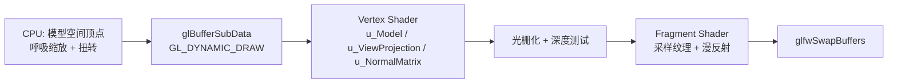

## Product Overview
在现有 ZHC 工程（GLFW + GLad + glm + minifb + stb_image，premake5 构建）里搭起一条最小可用的 3D 渲染链路：CPU 负责组装/加工顶点数据，GPU 负责顶点变换与光栅化，最终在 GLFW 窗口里显示一个贴着棋盘格纹理、带简单光照、会缓慢自转的立方体，并可用键盘鼠标自由观察。

## Core Features
- **CPU 传顶点**：CPU 每帧在模型空间重建/加工立方体顶点（呼吸缩放 + 沿 Y 轴随时间轻微扭转，法线同步旋转），通过动态顶点缓冲上传给 GPU
- **GPU 绘制**：顶点着色器用 uniform 传入的 MVP 矩阵做变换，片元着色器采样纹理并叠加简单漫反射光照
- **纹理贴图**：用 stb_image 解码 `assets/textures/Checkerboard.png`（64x64 RGB），上传为 GL 纹理
- **深度与索引**：24 顶点 / 36 索引的立方体，开启深度测试，保证面遮挡正确
- **透视相机**：WASD 前后左右移动、Space/Ctrl 升降，按住鼠标右键拖动旋转视角，滚轮调整 FOV，ESC 退出
- **窗口自适应**：窗口尺寸变化时同步更新视口与投影宽高比
- **保留 minifb**：构建脚本里继续带着，暂无调用，留给后续软件渲染对照

## 交付内容
一套可编译可运行的 3D 渲染代码骨架：顶点布局、顶点/索引缓冲、顶点数组、着色器、纹理、网格、相机的独立封装，配套 GLSL 着色器文件与资源目录，以及同步更新后的 premake 构建配置。


## 技术栈
- **语言/标准**：C++17（`cppdialect "C++17"`）
- **构建**：premake5 生成 VS2022（v143）工程，构建脚本为仓库根目录 `premake5.lua`
- **图形 API**：OpenGL 3.3 Core Profile + GLSL 330（`vendor/GLad/include`、`vendor/GLFW/include`）
- **数学库**：glm（纯头文件，`includedirs` 方式接入，不建工程）
- **图像解码**：stb_image（用户已放在 `vendor/stb_image/`，`stb_image.cpp` 中定义 `STB_IMAGE_IMPLEMENTATION`）
- **保留依赖**：minifb 静态库（继续编译链接，暂不调用）
- **实测环境**：VS2022 Community / v143，GPU 为 RTX 4070 SUPER，`GL_VERSION 3.3.0 NVIDIA`

## Implementation Approach

整体链路按「CPU 组装顶点 → 动态上传 → GPU 变换与光栅化 → 片元采样纹理与光照」划分，每帧只做一次顶点上传和一次 draw call。



**关键决策与理由**

1. **变换放在 GPU**：CPU 只维护模型空间几何，`u_Model * vec4(pos,1)` 与 `u_ViewProjection` 均在顶点着色器完成，符合用户选定的「CPU 只组装顶点、变换交给 GPU」。这样每帧 CPU 只写 24 个顶点（768 字节），MVP 用 uniform 传 64 字节，开销可忽略。
2. **CPU 每帧重建模型空间顶点**：立方体静止时顶点不变，为了真实体现「CPU 传顶点」这条链路，加入随时间变化的呼吸缩放与绕 Y 轴扭转（按顶点 Y 值决定扭转角），法线用同一旋转分量变换以保持光照正确。
3. **动态 VBO 用 `glBufferSubData` 而非每帧 `glBufferData`**：`glBufferData` 会重新分配显存对象；仅在容量变化时重建，容量不变时走 `glBufferSubData` 原地更新，避免显存反复申请释放。
4. **IndexBuffer 分离**：24 顶点 + 36 索引，`glDrawElements` 比 36 个顶点重复上传更省带宽，也为后续换模型留出接口。
5. **外部着色器文件**（`assets/shaders/Basic.vert|Basic.frag`）：便于改光照/贴图参数时不用重编译；采用 `debugdir "$(ProjectDir)"` 让 VS 调试时的工作目录固定为仓库根，`assets/...` 相对路径可直接使用。
6. **PCH 按 Hazel 约定**：`vendor/stb_image/stb_image.cpp` 第一行已引用 `hzpch.h`，因此补齐 `src/hzpch.h` / `src/hzpch.cpp` 并在 premake 中启用真 PCH（`pchheader` / `pchsource`），统一引入 glad、GLFW、glm 与常用 STL。**注意 PCH 必须在 `project "ZHC"` 块内设置**，若写在 workspace 级会污染 GLFW/GLad/minifb 三个库工程导致编译失败。
7. **不引入的内容（避免过度设计）**：Framebuffer/RenderPass、材质系统、ECS、资源管理器、模型加载器、实例化批处理、阴影。后续需要时可在现有 `Mesh`/`Shader`/`Texture` 上扩展。

**性能要点**

- 每帧成本：24 顶点重建 + `glBufferSubData(768B)` + 2 次 uniform 上传 + 1 次 draw call，均为常数级
- `glfwSwapInterval(1)` 开启垂直同步，避免空转把 GPU/CPU 打满
- `Shader` 首次使用时缓存所有 uniform location（`std::unordered_map<std::string,int>`），避免每帧 `glGetUniformLocation` 字符串查找
- 主循环用 `glfwGetTime()` 计算 delta time，动画速度与帧率解耦
- 不在热路径调用 `glGetError`（仅初始化阶段校验）

## Implementation Notes

- **PCH 统一约束**：ZHC 工程内所有 `.cpp` 的第一行有效代码必须是 `#include "hzpch.h"`（含 `vendor/stb_image/stb_image.cpp`）。`hzpch.h` 内需先 `#define GLFW_INCLUDE_NONE` 再 `#include <glad/glad.h>`，最后 `#include <GLFW/glfw3.h>`，顺序不能颠倒，否则 GL/GLFW 头冲突。
- **`assets` 目录不在 `src/` 下**，premake 的 `files` 通配覆盖不到，需显式加入 `"vendor/stb_image/stb_image.cpp"`。
- **stb_image 会触发 `fopen` 相关的 C4996 警告**，需给 ZHC 工程补 `_CRT_SECURE_NO_WARNINGS`，否则达不到零警告。
- **Core Profile 硬性要求**：每次绘制前必须绑定 VAO，否则 `glDrawElements` 直接报错；`glEnable(GL_DEPTH_TEST)` 与 `glClear(GL_COLOR_BUFFER_BIT | GL_DEPTH_BUFFER_BIT)` 缺一不可。
- **视口与 DPI**：用 `glfwGetFramebufferSize`（而不是 `glfwGetWindowSize`）设置 `glViewport` 并计算投影宽高比，否则在高 DPI 屏上画面会被拉伸。
- **资源路径与 CWD 耦合**：程序按当前工作目录解析 `assets/...`。premake 侧用 `debugdir "$(ProjectDir)"` 固定 VS 调试工作目录；若日后要脱离 VS 双击运行，再补 `postbuildcommands` 把 `assets` 拷到 exe 同级（注意 xcopy 无文件可拷时返回 1 会让构建失败，需用 `cmd /c "... & exit 0"` 包一层）。
- **minifb 保持可链接**：`links { "GLFW", "GLad", "minifb" }` 维持不变，即使当前没有调用 minifb 符号，静态库不被引用也不会产生未解析外部符号。
- **回归防线**：改动后必须同时跑 Debug 与 Release 两个配置，保持 0 warning 0 error；GLFW/GLad 的 `premake5.lua` 是库自带脚本，依赖 workspace 先定义 `outputdir`，不要改动它们。
- **可能的构建回退方案**：若 `pchheader`/`pchsource` 在本地 premake 版本上行为异常，删掉这两行即可退化为「普通头文件包含」模式（各 `.cpp` 仍显式 `#include "hzpch.h"`），不影响功能。

## Directory Structure

```
ZHC/
├── premake5.lua                                  # [MODIFY] ZHC 工程内新增 PCH 配置、stb_image 包含目录与源文件、debugdir、_CRT_SECURE_NO_WARNINGS；vendor 分组与 minifb 配置保持不变
├── assets/
│   ├── shaders/
│   │   ├── Basic.vert                            # [NEW] GLSL 330 顶点着色器：a_Position/a_Normal/a_TexCoord 输入，u_Model/u_ViewProjection/u_NormalMatrix 变换，输出 v_Normal/v_TexCoord
│   │   └── Basic.frag                            # [NEW] GLSL 330 片元着色器：采样 u_Texture，叠加半兰伯特漫反射与环境光，输出最终颜色
│   └── textures/
│       └── Checkerboard.png                      # 已存在（64x64，8bit RGB），作为立方体纹理
├── src/
│   ├── hzpch.h                                   # [NEW] 预编译头：GLFW_INCLUDE_NONE、glad/glad.h、GLFW/glfw3.h、glm 系列、常用 STL（vector/string/memory/cstdint/cmath 等）
│   ├── hzpch.cpp                                 # [NEW] PCH 编译单元，仅包含 hzpch.h，作为 premake pchsource
│   ├── main.cpp                                  # [MODIFY] 重写为完整 3D 演示：创建 GL 3.3 Core 窗口与上下文、帧缓冲尺寸回调、主循环（delta time、CPU 顶点加工上传、相机更新、清屏、绘制立方体、swap）、输入回调（WASD/升降/右键拖动/滚轮/ESC）、资源加载失败时的可读报错
│   ├── renderer/
│   │   ├── Vertex.h                              # [NEW] 顶点结构 Position/Normal/TexCoord（32 字节）与静态布局描述，供 VAO 与 Mesh 共用
│   │   ├── VertexBuffer.h/.cpp                   # [NEW] 封装 VBO：构造时按字节大小分配并指定 GL_DYNAMIC_DRAW，提供 SetData/SetSubData，析构释放 GL 对象，禁止拷贝
│   │   ├── IndexBuffer.h/.cpp                    # [NEW] 封装 EBO：上传 uint32_t 索引数组，暴露 Count 供 glDrawElements 使用
│   │   ├── VertexArray.h/.cpp                    # [NEW] 封装 VAO：按 Vertex 布局设置 location 0/1/2 的 glVertexAttribPointer 与 glEnableVertexAttribArray，Bind 时同时绑定 EBO
│   │   ├── Shader.h/.cpp                         # [NEW] 从文件读取顶点/片元源码（含 #version 校验与编译日志输出），编译链接程序，缓存 uniform location，提供 SetUniform(mat4/int/vec3/float) 重载与 Bind/Unbind
│   │   ├── Texture.h/.cpp                        # [NEW] 用 stb_image 解码图片（上下翻转、强制 RGBA），创建 GL 纹理并设置 GL_NEAREST + GL_REPEAT（适配棋盘格），提供 Bind 与 slot 参数；加载失败返回可读错误
│   │   ├── Mesh.h/.cpp                           # [NEW] 持有 CPU 侧 std::vector<Vertex> 与索引数组，拥有 VertexArray/VertexBuffer/IndexBuffer；提供 CreateCube(size) 工厂（24 顶点/36 索引，每面独立法线与 UV）、UploadVertexData()（容量变化走 glBufferData，否则 glBufferSubData）、Draw()（绑定 VAO + glDrawElements）、Vertices() 供 CPU 每帧加工
│   │   └── Renderer.h/.cpp                       # [NEW] 渲染状态封装：Init（深度测试开、背面剔除、深度函数）、Clear(颜色+深度)、SetViewport、DrawIndexed，集中管理 GL 状态避免散落调用
│   └── scene/
│       └── Camera.h/.cpp                         # [NEW] 透视相机：position/yaw/pitch/fov + moveSpeed/rotateSpeed，Update(dt) 处理 WASD/升降，SetRotation 处理鼠标拖动，Zoom 处理滚轮，GetViewMatrix/GetProjectionMatrix(aspect) 用 glm::lookAt 与 glm::perspective，并做 pitch 夹紧
└── vendor/
    ├── stb_image/{stb_image.h,stb_image.cpp}     # 已存在，仅需在 premake 中接入
    ├── GLFW/  GLad/  glm/  minifb-0.13.0/        # 已存在，不改动内部文件
    └── bin/premake/premake5.exe                  # 构建工具
```

## Key Code Structures

```cpp
// src/renderer/Vertex.h —— 贯穿 VAO 布局、Mesh、着色器 attribute location 的共享契约
struct Vertex
{
    glm::vec3 Position;
    glm::vec3 Normal;
    glm::vec2 TexCoord;
};
// location 0 = Position, 1 = Normal, 2 = TexCoord（与 Basic.vert 中的 layout 保持一致）

// src/renderer/Mesh.h —— CPU 传顶点链路的核心接口
class Mesh
{
public:
    static Mesh CreateCube(float size);
    std::vector<Vertex>& Vertices();   // 每帧在 CPU 侧加工模型空间顶点
    void UploadVertexData();           // 顶点数据上传到动态 VBO
    void Draw() const;                 // 绑定 VAO 后 glDrawElements
};
```


分层顺序（每层写完编译一次）
第 0 层：让工程能编译起来 —— src/main.cpp
写一个最小 GLFW 窗口：初始化 → 建 3.3 core 上下文的窗口 → make current → 加载 glad → 事件循环里清屏 + swap。

用的 API：glfwInit、glfwWindowHint、glfwCreateWindow、glfwMakeContextCurrent、gladLoadGLLoader、glfwPollEvents、glfwSwapBuffers、glfwWindowShouldClose
顺序坑：glad 的加载必须在 glfwMakeContextCurrent 之后，否则函数指针全是空
头文件顺序坑：先 #define GLFW_INCLUDE_NONE，再 #include <glad/glad.h>，最后 #include <GLFW/glfw3.h>
顺手加上 ESC 关闭窗口，不然后面调试要靠点 X 很烦
验证：窗口能开能关，glClearColor 的颜色生效
第 1 层：src/renderer/Vertex.h
纯头文件，一个结构体：位置、法线、UV。

为什么单独成文件：它是三处共享的契约——VertexArray 的偏移、Basic.vert 的 layout(location)、Mesh 生成顶点。三者必须严格对应，所以要有唯一来源
验证：编译通过
第 2 层：VertexBuffer → IndexBuffer → VertexArray
每个都是同一套模式：构造 glGen* + 绑定 + 上传；析构 glDelete*；禁用拷贝（删掉拷贝构造和赋值）。

VertexBuffer 要自己想清楚的三个问题：为什么用 GL_DYNAMIC_DRAW？每帧上传用 glBufferData 还是 glBufferSubData，区别是什么？什么情况下才需要重新 glBufferData？
IndexBuffer：GL_ELEMENT_ARRAY_BUFFER + GL_STATIC_DRAW，并记住索引个数给 draw call 用
VertexArray 的坑（这层最容易错）：
glVertexAttribPointer 记录的是"当前绑定的 VBO"，所以必须 先 bind VAO → 再 bind VBO → 再设属性
EBO 的绑定是 VAO 状态的一部分，所以设置完之后 不能在 VAO 还绑着的时候解绑 EBO，否则 VAO 记录的元素缓冲被清掉
验证：编译通过 + 初始化阶段可以用 glGetError() 自查一遍（这层还跑不出画面）
第 3 层：Shader + assets/shaders/Basic.vert / Basic.frag
读文件 → 编译单个 shader → 链接 program → 设 uniform。

用的 API：glCreateShader、glShaderSource、glCompileShader、glGetShaderiv(GL_COMPILE_STATUS)、glGetShaderInfoLog、glCreateProgram、glAttachShader、glLinkProgram、glGetProgramiv(GL_LINK_STATUS)、glGetProgramInfoLog、glGetUniformLocation、glUniform*
必须检查编译/链接状态并打印 info log，否则 GLSL 写错了你只会看到黑屏，排查成本极高
uniform location 查一次缓存起来，别每帧调 glGetUniformLocation（字符串查找）
链接完成后可以 glDeleteShader，program 自己持有结果
上传 mat4 时第三个参数是 GL_FALSE（表示传的是列主序，glm 正好是列主序）
着色器里：layout(location=0/1/2) 必须和 Vertex.h 成员顺序一致；u_Model、u_ViewProjection、u_NormalMatrix 从 uniform 进来，gl_Position 用 viewProjection × model × 顶点；片元里 texture(u_Texture, uv) 采样后乘上 max(dot(N,L), 0) 的漫反射加环境光
验证：编译通过
第 4 层：Texture
用的 API：stbi_set_flip_vertically_on_load、stbi_load、stbi_image_free、stbi_failure_reason、glGenTextures、glBindTexture、glTexParameteri、glTexImage2D、glGenerateMipmap、glActiveTexture
坑：图片原点在左上、GL 纹理原点在左下 → 要翻转；stbi_load 失败返回 nullptr，一定用 stbi_failure_reason() 打出原因（最常见就是工作目录不对）
采样参数：WRAP_S/T 用 GL_REPEAT；放大用 GL_NEAREST（棋盘格要锐利）；缩小只用 NEAREST 在远处会摩尔纹，所以配 glGenerateMipmap + GL_LINEAR_MIPMAP_LINEAR
绑定多个纹理时先 glActiveTexture(GL_TEXTURE0 + slot)
验证：编译通过
第 5 层：Mesh —— 第一次能真的看到画面
CPU 侧持有 std::vector<Vertex> + 索引数组，GPU 侧持有 VAO/VBO/EBO
CreateCube(size)：6 个面 × 4 顶点 = 24 顶点、36 索引。每个面 4 个顶点共享该面的法线，UV 每面用 (0,0)-(1,1)
最大的坑：顶点绕序决定正反面。开了背面剔除后，每个面的四个角点从外部看必须逆时针。自己拿右手定则验证：(B-A) × (C-B) 要指向该面的法线方向。弄错的表现是"立方体某些面是空的、能看穿"——先怀疑这里，不要先怀疑着色器
Draw()：bind VAO → glDrawElements(GL_TRIANGLES, indexCount, GL_UNSIGNED_INT, nullptr)
验证：在 main 里临时接上 shader，相机先用 glm::lookAt 硬编码一个位置，确认立方体出现、贴图正确、前后遮挡正确
第 6 层：Camera
维护：位置 + yaw/pitch 两个欧拉角，再由它们算出 front/right/up
每帧读按键移动（glfwGetKey），鼠标拖动改 yaw/pitch（pitch 要 clamp 到 ±89°，否则越过正上方会翻转）
glm::lookAt(position, position + front, up) 和 glm::perspective
宽高比要在 resize 回调里更新，用 glfwGetFramebufferSize 而不是 glfwGetWindowSize（高 DPI 屏上两者不相等，用错画面会被拉伸）
验证：能自由走动观察
第 7 层：Renderer（这层可以省，直接写 main 里也行）
集中放 GL 状态：glEnable(GL_DEPTH_TEST)、glClear(GL_COLOR_BUFFER_BIT | GL_DEPTH_BUFFER_BIT)、glViewport、背面剔除
为什么值得单独一层：以后加 framebuffer / 阴影，状态切换会变多，散在 main 里会失控
深度测试是硬性要求：只清颜色不清深度，立方体的面会乱盖
第 8 层：main.cpp 串起来 + CPU 传顶点
主循环骨架：算 deltaTime → glfwPollEvents → 相机更新 → CPU 加工顶点并上传 → 清屏 → 设 uniform → 绑定纹理 → 绘制 → swap
CPU 加工顶点（这是你这次的核心诉求）：对 mesh.Vertices() 里每个顶点做模型空间变换再上传。注意 法线要用同一个旋转再归一化，否则光照会跟着错
自转走 u_Model uniform，别和 CPU 侧加工混在一起，两者职责不同
验证：立方体转起来、贴图对、遮挡对、WASD + 鼠标可用


